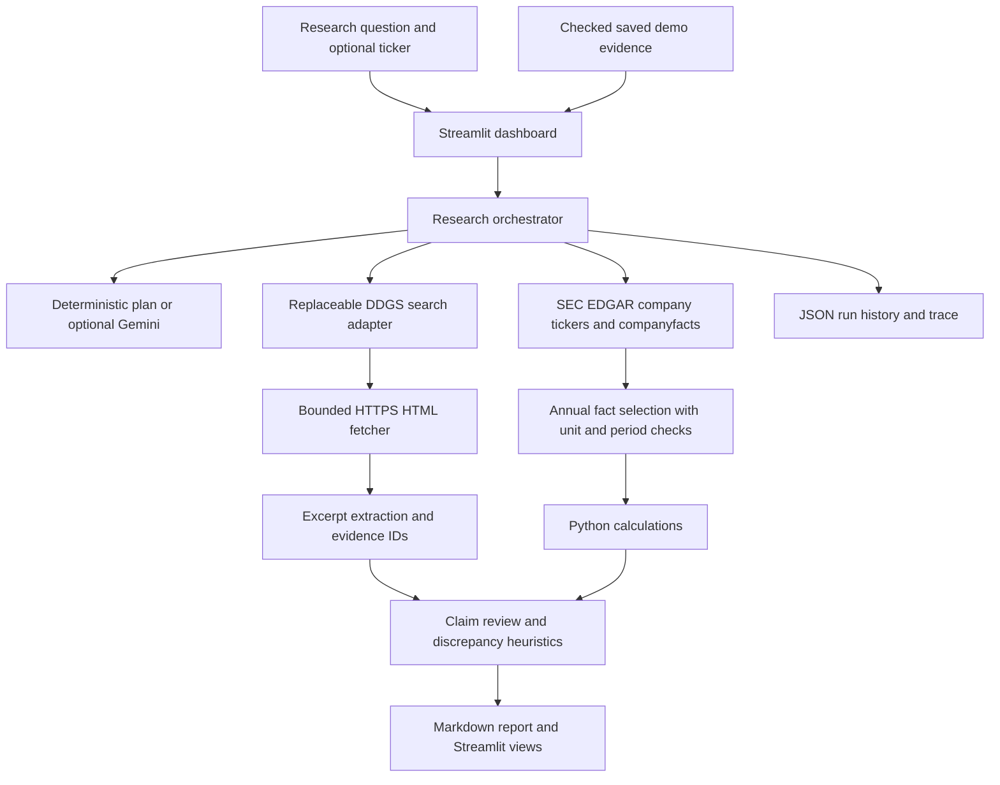

# Technical architecture

## Components and data flow

## Data sources

- **Web search:** DDGS returns public search results; the adapter can be replaced. Search result URLs are retained as original URLs.
- **Web pages:** Requests retrieves bounded HTTPS HTML. BeautifulSoup extracts readable text, title, canonical URL, and available dates. Authentication, paywalls, and access controls are not bypassed.
- **Financial data:** SEC public company tickers and XBRL companyfacts endpoints. The selected fact retains concept, label, unit, fiscal year/period, duration, form, accession, and filing URL.
- **Optional model:** Google's `google-genai` SDK is used only when a key is configured. Planning can fall back deterministically; interpretation is exploratory and does not perform arithmetic.

## Evidence and verification

Evidence IDs associate a report claim or metric with the evidence records available in the run. Retrieved means text/data was obtained; it does not mean a claim was independently verified. The verification module checks cited IDs, source type, textual overlap, obvious numeric/directional conflicts, and period/definition differences for reported claims. Calculated findings are not treated as corroborated or contradicted by loosely matched webpage numbers; they remain partially supported unless a future structured check can match the exact metric and period. It cannot establish source independence or truth. Distinct domains are only a necessary heuristic. In this version, related pages are not searched separately for each claim, so counter-evidence coverage is limited to the initial result set.

## Calculation controls

Annual SEC facts are selected only from 10-K duration rows with a full-year-like period. Year-over-year comparisons require matching units, fiscal periods, supported forms, duration facts, and comparable durations. Free cash flow is operating cash flow minus capital expenditure only when period and unit match exactly. No currency conversion is performed. General webpage prose is not parsed as numeric financial data.

## Local persistence and boundaries

Streamlit holds the active result in session state. JSON history and Markdown reports are written locally when selected. The saved demo reads checked project fixtures and performs no live retrieval. This local prototype is not hardened for public multi-user deployment; enforce your own network egress and user-input controls before any such use.
